


  
  

 

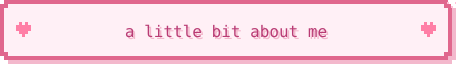


  

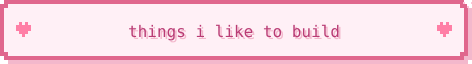

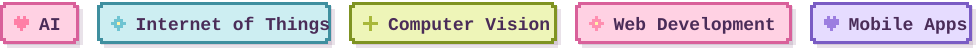

  

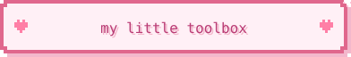

 

  

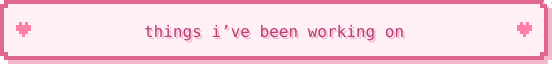

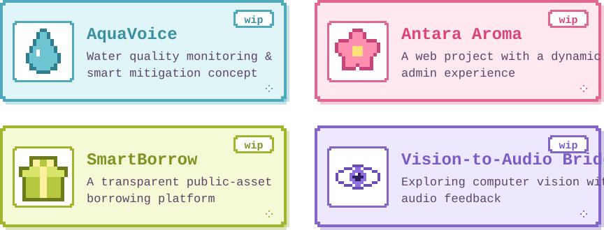

✿ some projects are still blooming — more little creations coming soon! ✿

  

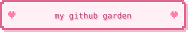

 

  

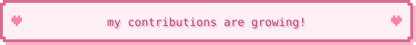

<picture>
  <source media="(prefers-color-scheme: dark)" srcset="https://raw.githubusercontent.com/laupiy/laupiy/output/snake-dark.svg" />
  
</picture>

  


 

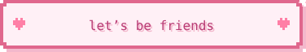

 

  


